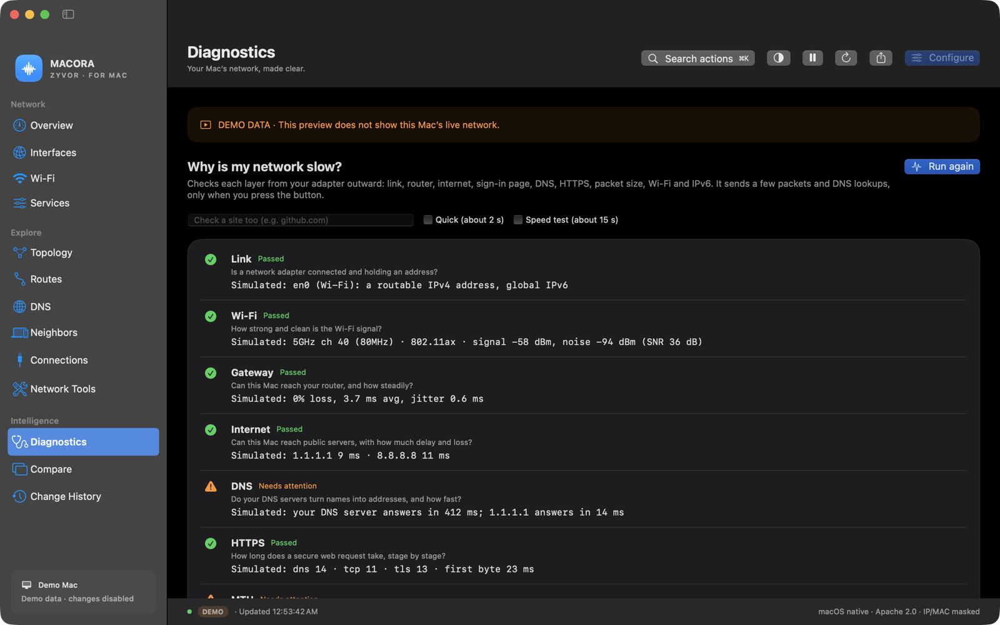
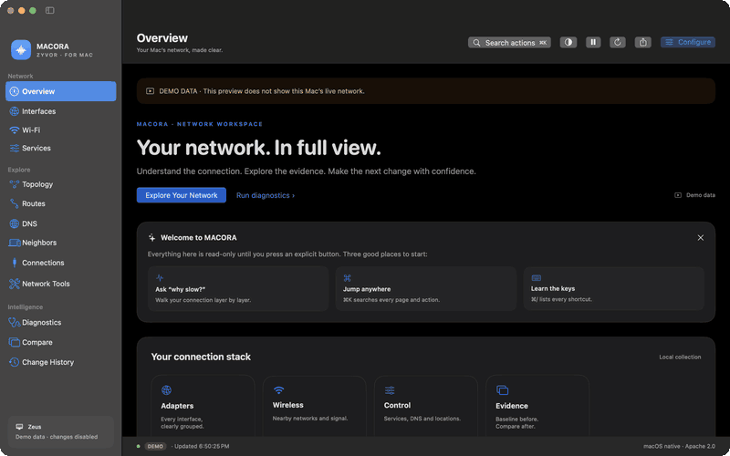
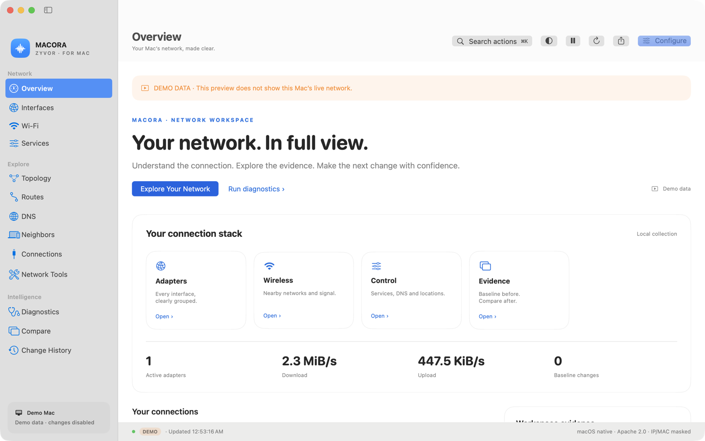
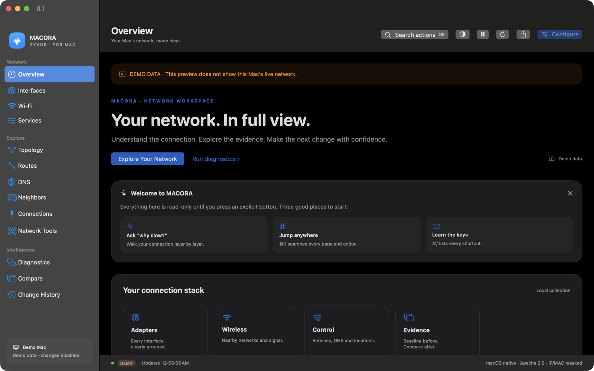
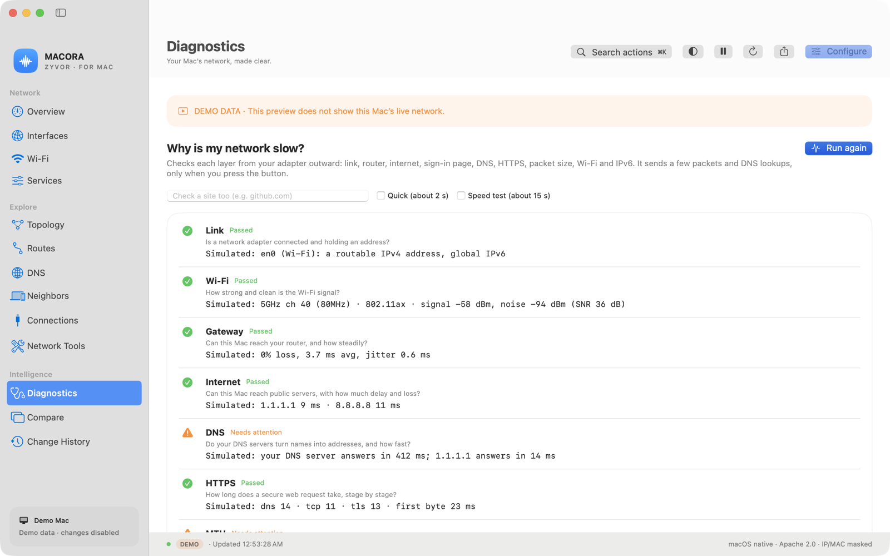
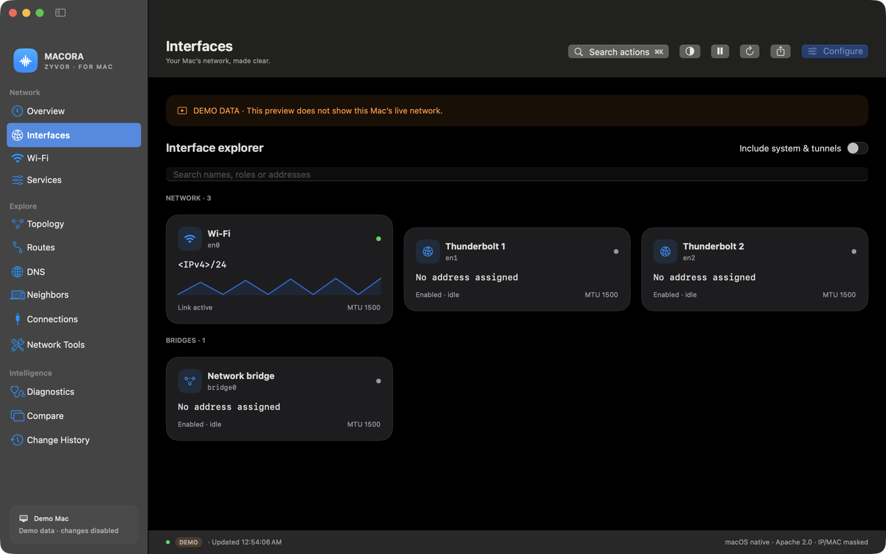
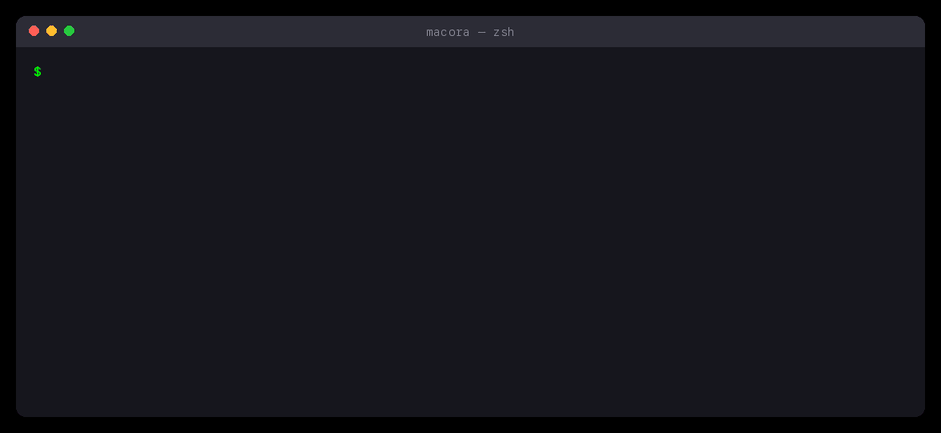
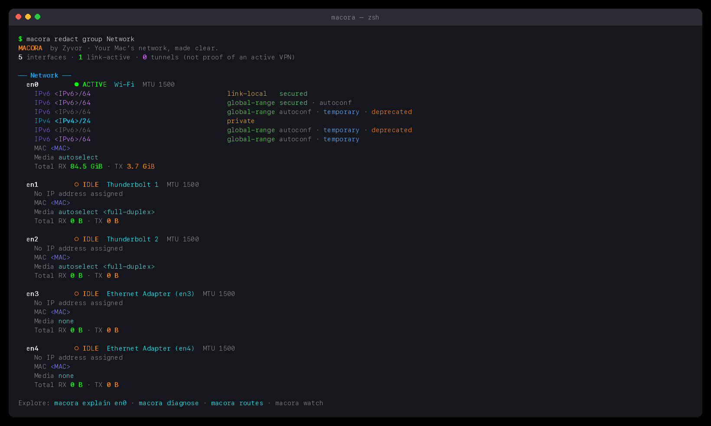
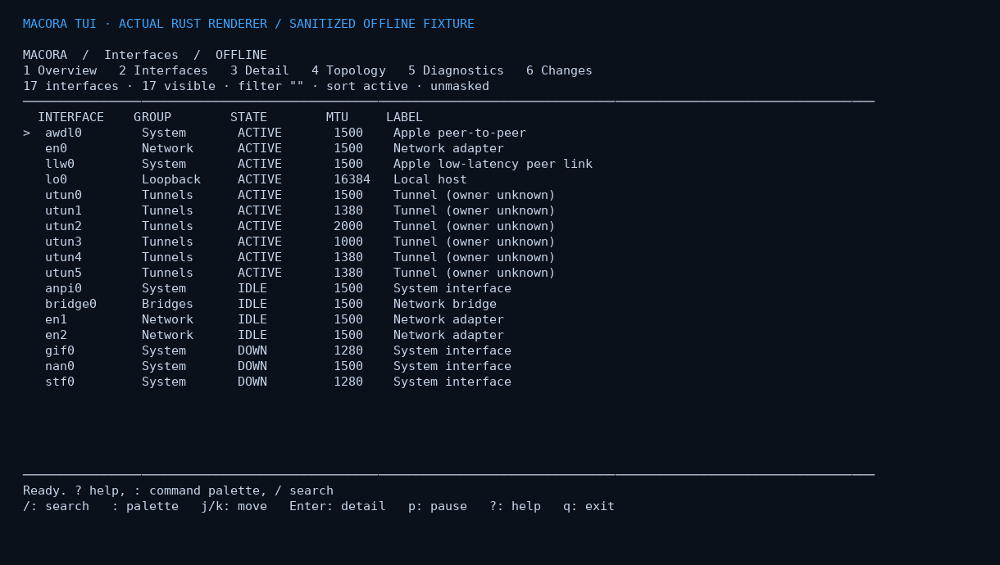
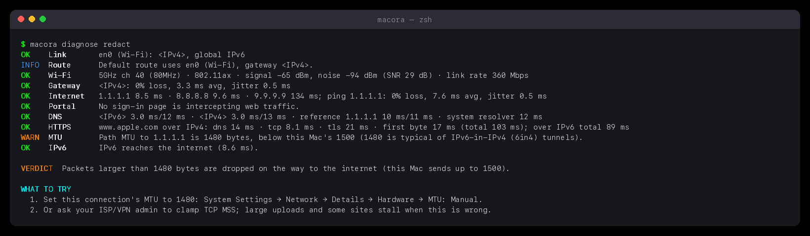

<div align="center">

# MACORA

[](https://github.com/zyvorai/zyvor-macora/actions/workflows/ci.yml)
[](LICENSE)
[](docs/TESTING.md)
[](Cargo.toml)
[](Cargo.toml)



### Your Mac’s network, made clear.

**A native SwiftUI workspace, a Rust CLI and an interactive terminal that explain what your network is doing, and why it feels slow.** Interfaces grouped and annotated, a one-click diagnosis, live traffic, scoped DNS and routes, and deliberate configuration controls. Built by Zyvor AI Labs.

**Read-only by default** · **Zero dependencies** · **Native + CLI + TUI** · **Redact before you share** · **Local-first, no telemetry**

🌐 **[Site](https://zyvorai.github.io/zyvor-macora/)** · 🚀 **[Quickstart](#quickstart)** · 🩺 **[Diagnose](#why-is-my-network-slow)** · 🔒 **[Security](SECURITY.md)** · 📖 **[Docs](#documentation-map)** · 🤝 **[Contributing](CONTRIBUTING.md)**

</div>

## Why MACORA

| When this happens | MACORA gives you |
| --- | --- |
| `ifconfig` prints a wall of 17 interfaces and you only care about Wi-Fi | Interfaces **grouped** (Network, Bridges, Tunnels, System, Loopback) with each flag, scoped IPv6 address and bridge member explained |
| "The internet is slow" and you do not know where to look | **`macora diagnose`**: link → router → internet → DNS → HTTPS → path MTU (+ Wi-Fi, IPv6), naming the lowest layer that is really wrong, with what to try |
| You need to send someone your network details | **`redact`** masks IPs and MACs; export Markdown, HTML or JSON; snapshots are private (0600) and never overwritten |
| "What changed since it last worked?" | Capture a baseline, then **diff** field by field, in the app or `macora diff` |
| You want it in a dashboard or a script | `watch prometheus`, NDJSON, `json` on every command, shell completions, Shortcuts actions |
| You will run it on a machine you care about | **Read-only**: nothing changes without a preview and an explicit `apply` or authorization dialog |

## See it



*A slideshow of real captures of the app running its built-in **simulated demo data** (`--demo`). Values are not from a real network.*

| Overview, light | Overview, dark |
| --- | --- |
|  |  |

| Diagnosis, light | Interfaces with sparklines, dark |
| --- | --- |
|  |  |

## In the terminal



*Real `macora` output from a live Mac, rendered into an image by [`scripts/render-terminal.py`](scripts/render-terminal.py). Addresses are masked with `redact`; the diagnosis shows the gateway's private address.*



It works like `ifconfig`, with plain words instead of dashes: `macora en0`, `macora en0 raw` (ifconfig's own text), `macora list up`. Colors turn off in pipes and with `NO_COLOR`.

And the full-screen workspace, `macora tui`:



## Quickstart

Needs macOS 14+, the Xcode command line tools and Rust.

```sh
git clone https://github.com/zyvorai/zyvor-macora.git && cd zyvor-macora

./scripts/install-macos.sh ~/.local     # CLI + man page + completions (PREFIX optional)
macora diagnose                           # why is my network slow?
macora tui                                # full-screen workspace

./scripts/build-macos.sh                  # tests, then dist/Macora.app (ad-hoc signed)
open dist/Macora.app                      # or add --args --demo for simulated data
```

Download `Macora-0.3.1.dmg` (drag to Applications) or `Macora-0.3.1.pkg` from the [Releases page](https://github.com/zyvorai/zyvor-macora/releases), or the [site](https://zyvorai.github.io/zyvor-macora/#install). Both are signed with Zyvor AI Labs' Developer ID and **notarized by Apple** (Apple silicon, macOS 14+), so they open without a Gatekeeper warning; each has a `.sha256`. The CLI tarball is signed but not notarized. Builds from the [release workflow](.github/workflows/release.yml) are notarized only when the Apple secrets are configured in the repository. With Homebrew (the tap installs the notarized app, or just the CLI):

```sh
brew install --cask zyvorai/tap/macora   # MACORA.app and `macora` on your PATH
brew install zyvorai/tap/macora          # the command line tool only
```

Install one or the other: they provide the same `macora` command.

There are **zero external Rust crates and zero external Swift packages**. SwiftUI, Charts, CoreWLAN, CoreLocation, AppKit and AppIntents are Apple system frameworks. No server, webview or daemon.

## Why is my network slow?

```text
$ macora diagnose
OK    Link       en0 (Wi-Fi): 192.0.2.8, global IPv6
INFO  Route      Default route uses en0 (Wi-Fi), gateway 192.0.2.1.
OK    Wi-Fi      5GHz ch 40 (80MHz) · 802.11ax · signal -64 dBm, noise -94 dBm (SNR 30 dB) · link rate 360 Mbps
OK    Gateway    192.0.2.1: 0% loss, 4.3 ms avg, jitter 0.9 ms
OK    Internet   1.1.1.1 10 ms · 8.8.8.8 11 ms · 9.9.9.9 138 ms; ping 1.1.1.1: 0% loss, 9.0 ms avg, jitter 0.6 ms
OK    Portal     No sign-in page is intercepting web traffic.
OK    DNS        192.0.2.1 6.0 ms/13 ms · reference 1.1.1.1 10 ms/12 ms · system resolver 41 ms
OK    HTTPS      www.apple.com over IPv4: dns 11 ms · tcp 17 ms · tls 13 ms · first byte 22 ms (total 103 ms); over IPv6 total 96 ms
WARN  MTU        Path MTU to 1.1.1.1 is 1480 bytes, below this Mac's 1500 (1480 is typical of IPv6-in-IPv4 (6in4) tunnels).
OK    IPv6       IPv6 reaches the internet (13 ms).

VERDICT  Packets larger than 1480 bytes are dropped on the way to the internet (this Mac sends up to 1500).

WHAT TO TRY
  1. Set this connection's MTU to 1480: System Settings → Network → Details → Hardware → MTU: Manual.
  2. Or ask your ISP/VPN admin to clamp TCP MSS; large uploads and some sites stall when this is wrong.
```



That is real output from a real Mac, lightly edited (documentation addresses instead of mine, one IPv6 DNS server line dropped, two runs' lines combined), and the MTU warning is a real finding: this network drops packets over 1480 bytes while the Mac sends 1500. The walk goes bottom-up and the verdict blames the **lowest layer that is actually wrong**. A router that ignores ping but passes traffic is a warning, not an outage. Words extend it:

```sh
macora diagnose quick               # about 2 s: skip Wi-Fi details and the packet-size search
macora diagnose to github.com       # why is THIS site slow? DNS per server, HTTPS stages, path
macora diagnose speed               # add Apple's networkQuality: Mbps and responsiveness
macora diagnose redact md           # a shareable report with your addresses masked (also: html, json)
macora diagnose count 10 interval 30   # repeat and summarize what flapped
macora diagnose strict              # exit 1 on warnings too
```

It checks link, route, Wi-Fi quality, router (loss and jitter), internet (three targets), captive portals, every DNS server separately, an HTTPS timing breakdown, **path MTU**, IPv6 and proxies, only when you run it, and changes nothing. See [docs/DIAGNOSE.md](docs/DIAGNOSE.md) for how each check works, the thresholds, what is sent and the caveats. The app has the same check on the Diagnostics page (with a site field, quick and speed options, advice and a masked "Copy report"), in the menu bar panel and as a Shortcuts action.

## CLI cookbook

```sh
macora                                # Connected adapters first; system groups collapsed
macora all                            # Expand everything (tunnels, system links, loopback)
macora en0                            # One interface, explained
macora en0 raw                        # ...or ifconfig's own text for it
macora list                           # Interface names in system order, like ifconfig -l
macora list up                        # ...only the ones that are up (also: down)
macora ipv6 group Tunnels             # Words combine: one family, one group
macora explain en0                    # Flags, IPv6 and role in plain words
macora doctor                         # Local interface findings (no network traffic)
macora diagnose                       # Link, router, internet, DNS, HTTPS, path MTU, Wi-Fi, IPv6 + verdict
macora ping 1.1.1.1 count 5           # Loss and latency
macora trace example.com              # Hop-by-hop path
macora report html redact > report.html
macora report md
macora watch count 10 interval 1 json # NDJSON frames, counters and rates
macora watch prometheus               # Text exposition for scraping
macora snapshot before.macora         # Exact ifconfig capture, mode 0600; no overwrites
macora diff before.macora after.macora redact
macora all from before.macora         # Inspect a capture offline
macora services | wifi | routes | dns | neighbors | sockets | path | topology
macora resolve example.com            # Explicit DNS lookup
macora subnet 192.168.1.8/24
macora probe 1.1.1.1:443 timeout 1500 # Explicit outbound TCP connection
macora en0 mtu 1400                   # Preview only
sudo macora en0 mtu 1400 apply        # Explicit change; the device may reject it
macora tui theme high-contrast        # default | mono | high-contrast
macora completions zsh > ~/.zsh/completions/_macora  # also bash, fish
macora json                           # Any command takes json for machine-readable output
```


Options are plain words, not dashes: `json`, `redact`, `html`, `md`, `prometheus`, `from FILE`, `count N`, `interval S`, `theme NAME`. Colors turn off in pipes and with `NO_COLOR`; `color always|never` overrides. `macora help` lists everything; `man macora` is installed by the install script. The older `--flag` spellings still work for scripts, but are no longer documented.

`up` means administratively enabled; link-active is a different property. `utun` presence does **not** establish VPN ownership or connectivity. `en0` is not assumed to be Wi-Fi: hardware port names come from `networksetup`. Global-range address labels do not verify internet reachability. UI traffic sums the Network adapter group only, reducing tunnel/bridge double counting; it is not per-process bandwidth accounting.

Snapshots contain private network data. Redaction masks IP and MAC values present in the interface model; it does not anonymize interface labels, service names, SSIDs, proxy settings, route/DNS inspectors or arbitrary copied text. Raw captures and full exports stay intentionally unredacted.

## Native app

- **Overview:** active adapter count, live RX/TX, a 90-sample in-memory traffic chart, clear interface cards, pause/resume and refresh timestamps. Missing counters remain unavailable rather than being invented.
- **Interface explorer:** group and search adapters, tunnels, bridges, loopback and Apple peer interfaces; inspect addresses, scopes, temporary/deprecated IPv6 attributes, MTU, MAC, media, flags, offloads and bridge members.
- **Wi-Fi:** user-triggered CoreWLAN discovery, signal strength, channel, security class, join open/personal networks, and confirmed disconnect. Network names may require Location permission. Enterprise 802.1X and saved-credential management open System Settings.
- **Services:** DHCP/static IPv4, automatic/link-local/static IPv6, custom DNS and reset to automatic, search domains, HTTP/HTTPS/SOCKS/PAC proxies, proxy bypass entries, per-proxy disable, Wi-Fi power, forgetting a preferred network, MTU, service enable/disable and exact service priority ordering.
- **Locations:** create populated network locations, switch locations, and delete an existing location with the same preview/authorization flow.
- **Explore:** full IPv4/IPv6 route tables, every scoped DNS resolver, ARP/IPv6 neighbors and TCP/UDP sockets visible to the current user. These pages retain native diagnostic output in a selectable inspector.
- **Diagnostics:** self-assigned IPv4, missing address assignment, duplicate/tentative IPv6, normal privacy rotation, low tunnel MTU, inactive bridges, and default route/reachability inspection.
- **Workspace:** Cmd-K action search; observed topology; imported/captured JSON baselines; counter-independent change comparison; bounded in-memory change timeline; pinned adapters; menu bar monitoring; persistent appearance/density/refresh preferences.
- **Network tools:** user-triggered numeric TCP probes, local IPv4 subnet calculations, system DNS lookups and redacted interface evidence reports.
- **Change preview:** a validated command and consequence before any settings mutation; the macOS authorization dialog handles the administrator password. Wi-Fi association uses a separate explicit join sheet and CoreWLAN.
- **Sharing:** full or IP/MAC-redacted JSON export with private file permissions; successful configuration history stays in memory for the current app session.
- **Light and dark:** system appearance, semantic native colors, blue accents, rounded cards, sidebar navigation and keyboard shortcuts.

Open the review sheet with **Configure → Action → target → Preview Change → Authorize & Apply**. No mutation runs merely by selecting a menu item or typing in a field. There is no automatic rollback. CoreWLAN joins and disconnects can also interrupt a connection, so both have explicit user actions.

### Polish

First-run welcome card, per-adapter sparklines, a menu-bar panel (rates, "Why slow?", copy redacted summary), a keyboard cheat sheet (**⌘/**), an accent color preference, a DEMO/LIVE badge, Reduce Motion support, and Shortcuts actions "Network status" and "Why is my network slow?". Useful keys: **⌘K** palette, **⌘R** refresh, **⇧⌘P** pause, **⇧⌘D** diagnose, **⇧⌘C** copy redacted summary, **⇧⌘E** export.

## Interactive terminal

```sh
macora interactive              # Persistent command session
macora repl from tests/fixtures/macos.ifconfig
macora tui all interval 1       # Live full-screen workspace on a Mac
macora tui from tests/fixtures/macos.ifconfig
```

In the REPL, use `select en0`, `detail`, `baseline`, `refresh`, `changes`, `history`, `redact on`, `export FILE` and `help`. A settings plan is never executed without explicit apply and exact terminal confirmation. The TUI uses `/` to filter, `:` for its palette, 1–6 for pages, arrows/j/k for navigation, `b` for baseline, `p` for pause and `q` to exit. [Full guide](docs/INTERACTIVE.md).

## NetworkManager-style coverage

MACORA uses macOS network services and locations rather than Linux NetworkManager profiles, `nmcli`, netlink or systemd. See [the precise feature mapping](docs/FEATURES.md). Custom VPN providers, enterprise certificate workflows, firewall engines, Internet Sharing and virtual bridge/VLAN creation remain in System Settings or require future privileged/network-extension implementations. It does not promise complete Linux NetworkManager parity.

## Documentation map

| Doc | What is in it |
| --- | --- |
| [docs/ARCHITECTURE.md](docs/ARCHITECTURE.md) | Collector, JSON schema, native app structure |
| [docs/DIAGNOSE.md](docs/DIAGNOSE.md) | How `diagnose` works: checks, thresholds, formats, privacy, caveats, tests |
| [docs/FEATURES.md](docs/FEATURES.md) | Exact macOS ↔ NetworkManager-style mapping |
| [docs/INTERACTIVE.md](docs/INTERACTIVE.md) | REPL and TUI guide |
| [docs/UX.md](docs/UX.md) | Design and interaction notes |
| [docs/TESTING.md](docs/TESTING.md) | What was run, how to repeat it, manual hardware checklist |
| [docs/RELEASE.md](docs/RELEASE.md) | Tagging, signing, notarization, repo settings |
| [SECURITY.md](SECURITY.md) · [CONTRIBUTING.md](CONTRIBUTING.md) · [CHANGELOG.md](CHANGELOG.md) | Policy, how to help, history |

## Project layout

```text
src/                  Dependency-free Rust CLI, parser, collector, probes, exporters, TUI
tests/                Scenario, interactive and feature tests; sanitized fixtures
macos/Sources/        SwiftUI app (MacoraApp) and testable core (MacoraCore)
macos/Tests/          Command validation, JSON, diagnosis and traffic tests
scripts/              build-macos, package-mac, install-macos, smoke-cli, shots, PTY tests
completions/ man/     bash, zsh and fish completions; macora(1)
site/                 GitHub Pages landing page
.github/              CI, release and Pages workflows; templates; Dependabot
```

## Validation status

Run on an Apple silicon Mac (the 0.3.1 DMG and pkg were also signed, notarized, stapled and accepted by Gatekeeper): **59 Rust tests, 4 pseudo-terminal tests, 27 Swift tests**, rustfmt, Clippy with warnings denied, the app build, packaging (DMG, pkg, tarball, verified checksums) and a **59-check read-only smoke test** of the CLI against the live machine. **Not yet run:** Intel Macs, notarization, administrator-authorized configuration changes, Wi-Fi join/disconnect and Location-permission flows. See [TESTING.md](docs/TESTING.md) for exact checks and the hardware acceptance checklist. Screenshots show simulated demo data.

## Roadmap

Notarized CI releases (today they are notarized by hand) · per-process bandwidth (needs a privileged helper, not planned for the sandbox-free app) · Intel verification · more captured fixtures from other macOS versions (PRs welcome).

## License

Copyright 2026 Zyvor AI Labs. Licensed under **Apache License 2.0**, including the Rust CLI and Swift application. See [LICENSE](LICENSE) and [NOTICE](NOTICE). The design takes broad inspiration from Zyvor Vytrix's sidebar/card layout; this is new source code, not a fork, and shares no code or assets.
