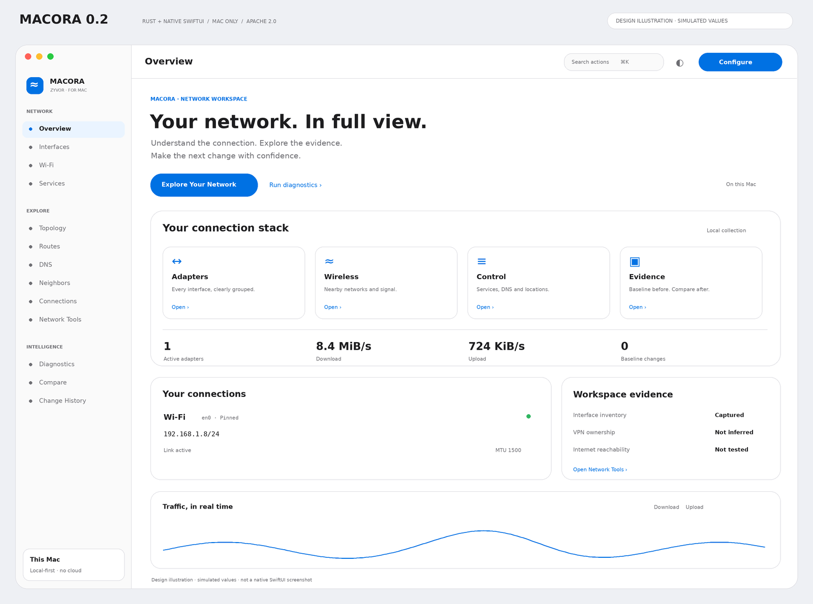
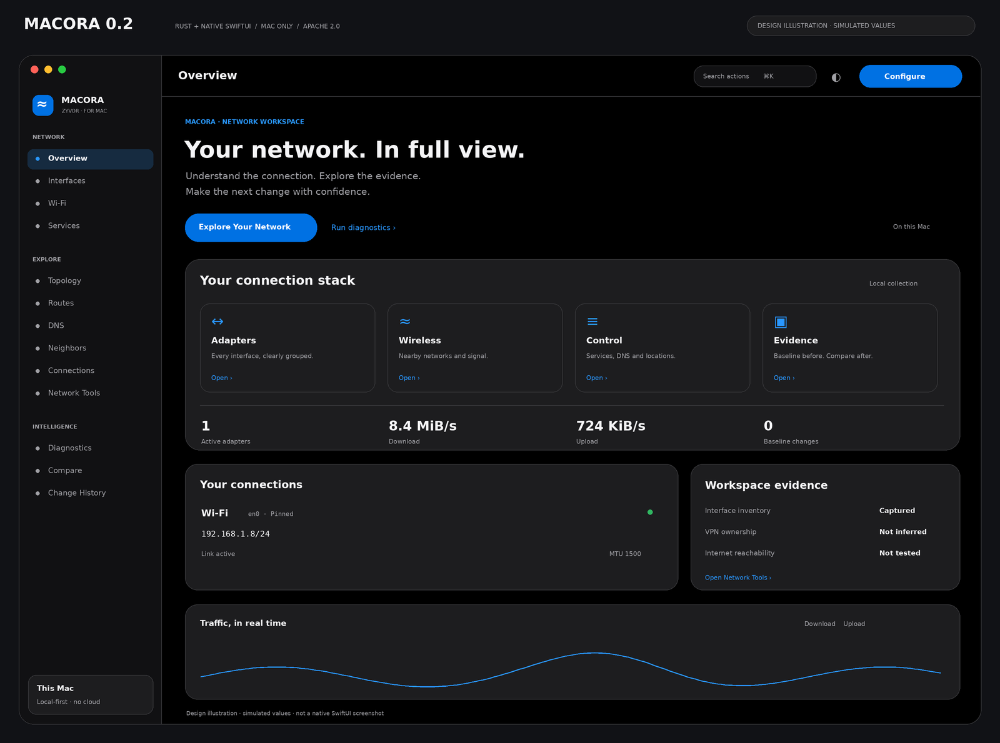

# Native workspace design and source references

MACORA 0.2 follows a three-level composition: the overview introduces the network through one spacious stage; interface and service browsing uses compact grouped records; diagnostics and configuration use denser work surfaces with inline evidence. Color is restrained: blue signals an action, and status colors describe an observed state rather than an invented health grade. Light pages and surfaces are white with hairlines; dark pages are black with elevated graphite surfaces.

The source references were inspected through GitHub:

- Nuvora's public design contract, `docs/design/APPLE-UX-CONTRACT.md`, and light/dark overview screenshots at repository tree `7451dca9a43c2d603fbd63d279b716271fa8131e`: https://github.com/zyvorai/zyvor-nuvora
- GuestKit's interactive-mode guide and TUI command-palette flow at repository tree `0a5c429241427ea31b06ef6c7d75e897b3705143`: https://github.com/zyvorai/zyvor-guestkit

These references guide layout and interaction; no Nuvora stylesheet, component, screenshot or other source asset is distributed here. MACORA's implementation and original icon remain Apache 2.0. The native overview previews are newly rendered design illustrations, not captures of a running SwiftUI app. The terminal image renders actual Rust TUI output against the sanitized fixture.

Cmd-K opens a fuzzy command palette. The 17 catalog actions cover page navigation, configuration, baseline capture, export and preferences. Keyboard arrows choose a result; Return opens it. The main inspector remains a native SwiftUI sidebar workspace.

Appearance, density, refresh rate, IP/MAC masking and pinned interface names are stored locally through UserDefaults. Credentials, snapshots, Wi-Fi names, comparison results and traffic history are not persisted by these display preferences. The chart retains 90 samples; the observed-change timeline retains 200 events, both in memory. The menu bar and main window share one idempotently started polling task.

Masking is deliberate and narrow: modeled current/baseline IP and MAC values are masked in interface, topology and comparison views. Raw system inspectors and network-tool outputs carry their own evidence and remain unredacted. Redacted export is a separate explicit action. Native Preferences includes a reminder about these boundaries.

Network tools run only after the user presses Run. Subnet calculations are local, TCP uses a numeric endpoint with a bounded timeout, DNS uses the configured macOS resolver, and the evidence report performs no external probe. Demo mode disables live network tools; a local subnet calculation remains available.

New imported JSON baselines are version-checked, size-limited and reject duplicate interface names. An imported baseline is comparison evidence only; the live collector remains the authority for actual configuration actions.

